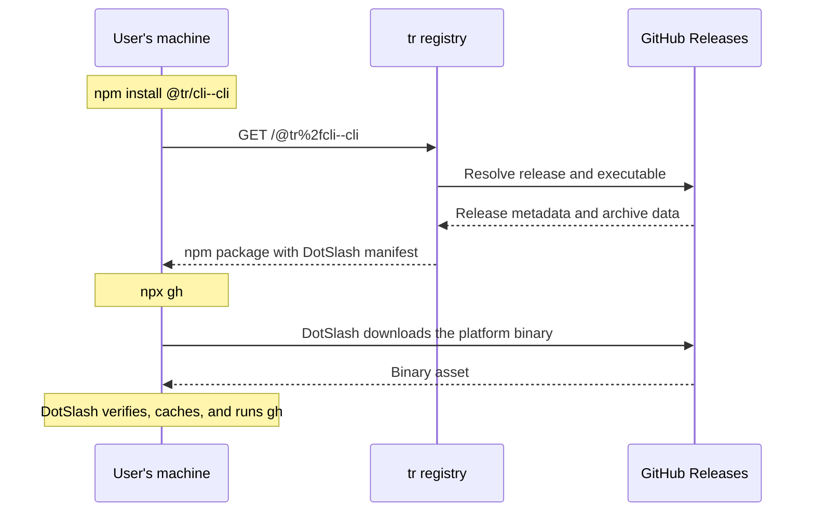

# tr (Tool Registry)

Install CLI tools from GitHub Releases and manage them in your `package.json`.


Packages are named `@tr/<owner>--<repo>`. For example, `@tr/cli--cli` installs
GitHub CLI (`gh`) from [cli/cli](https://github.com/cli/cli).

## Usage

With Node.js 20+ and npm 7+, add the preview registry to your project's
`.npmrc`:

```ini
@tr:registry=https://tr.ras0q.com
```

Install and run a tool:

```sh
npm install --save-dev @tr/cli--cli
npx gh --version
```

Run tools through `npx` or npm scripts so their interpreter is on `PATH`.

## How it works

tr packages a Meta's [DotSlash](https://dotslash-cli.com/) manifest instead of
the tool's binary. On first use, DotSlash downloads the binary for your OS and
architecture, verifies its SHA-256, and caches it for subsequent runs.



New packages resolve the latest public GitHub Release. Previously published
exact versions remain available; looking up unpublished older releases is not
yet supported.

For local development and contribution guidelines, see
[CONTRIBUTING.md](CONTRIBUTING.md).
